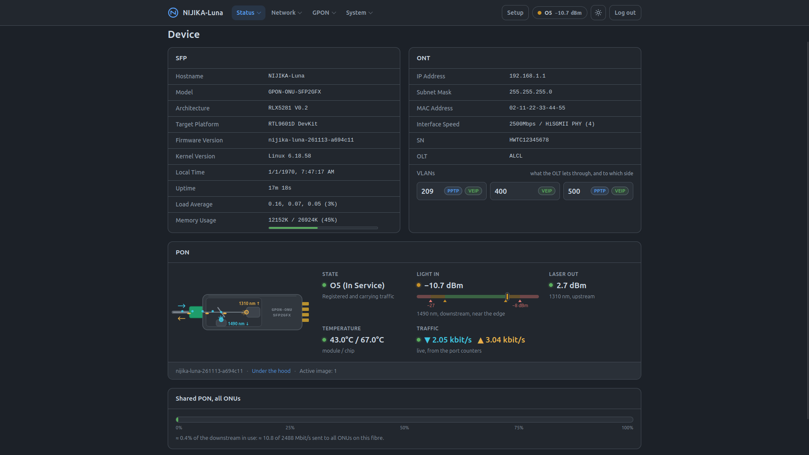
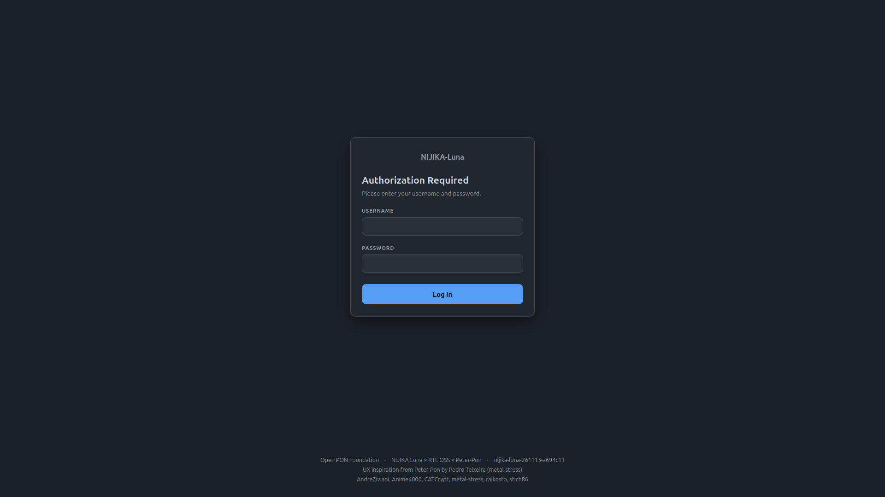
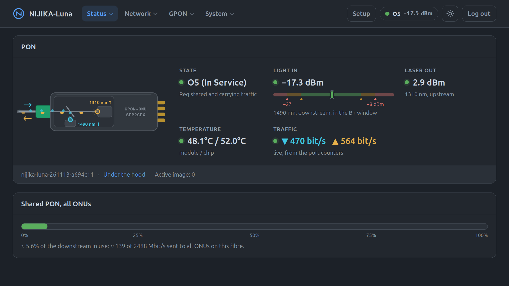
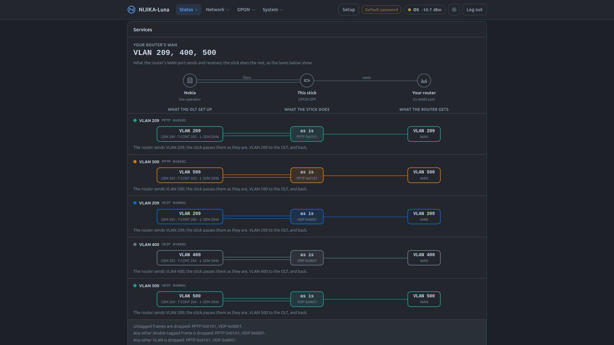
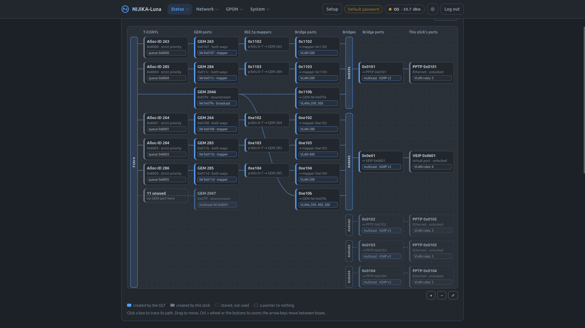
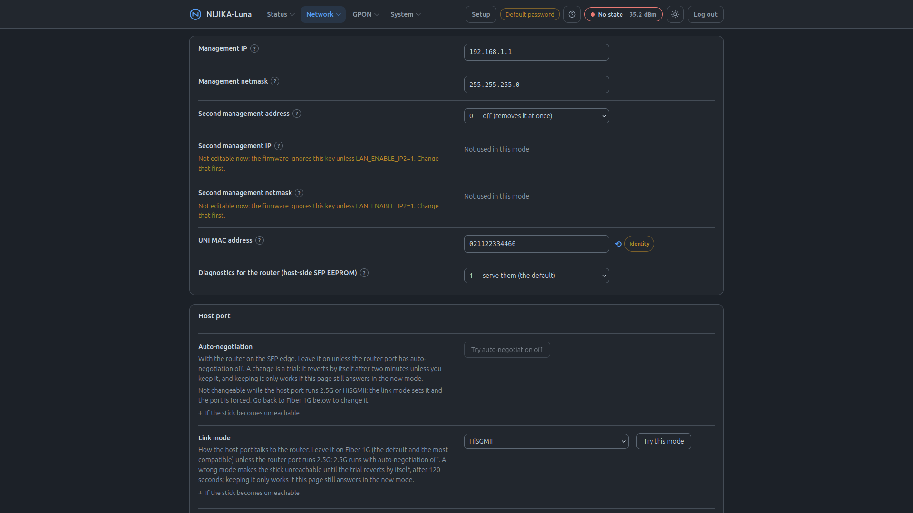
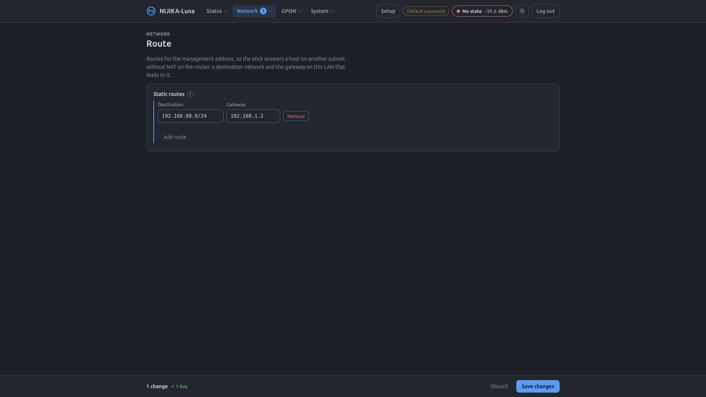

# Nijika UI

The web interface of **Nijika Luna**, the Nijika firmware for the HSGQ / ODI
GPON SFP stick (Realtek RTL9601D). It is the upgrade from the web pages of the
classic **NIJIKA firmware**: the same four menus you know, redrawn as a clean,
calm page in the spirit of OpenWrt's LuCI, for anyone who wants the stick on
their fibre and their router online without first learning OMCI.



Nijika UI is a fork of [odi-ui](https://github.com/AndreZiviani/odi-ui) by
Andre Ziviani and runs on its `confd` daemon, schema and API. Every odi-ui
view is in the Nijika menu, and odi-ui's own page stays whole at `/odi`,
shown when the stick is told to (below).
[odi-ui's README](#odi-ui) follows below this part.

## What you get

- **It feels like your router.** A top bar of drop-down menus (Status,
  Network, GPON, System), settings on cards, light and dark themes, and a
  menu button on a phone. If you have used LuCI on OpenWrt, you already know
  your way around.
- **The line at a glance, on every page.** The pill in the top bar shows the
  ONU state and the light coming in (`O5 −10.7 dBm`). Status > Device puts
  that light on a bar against the class B+ window, next to the laser, the
  temperature, live traffic and how much of the shared PON is in use.
- **Your service, drawn.** Status > Service starts with what your router's
  WAN port needs (the VLANs, or untagged), then shows one lane per service
  from the OLT, through the stick, to the router, with a sentence on what
  happens to the tag. Status > OMCI Topology draws everything the OLT set
  up, from the fibre to the ports; click a box to light up its path.
- **Plain words first.** Every setting says what it does in a sentence, and
  the `?` button opens the help of every field at once. Key names and expert
  settings stay out of sight until you turn them on in System > Advanced.
- **Changes you can trust.** Edits wait in a save bar at the bottom, counted
  on the menu, with Discard and Save changes. Each setting is marked with
  what saving it costs: nothing for a live change, 🔄 a service restart, ⚠️ a
  short break in the internet, ⟲ a reboot. A change that could cut you off
  from this page (the management address, routes, the host link mode,
  auto-negotiation) is a trial, and goes back by itself unless you press
  Keep in time.
- **Device emulation in one pick.** GPON > ONT Identity lists the Nijika
  presets, with the Huawei HG8240H as the default, or Custom to fill in
  every field yourself. Serial number, PLOAM password and LOID are under
  GPON > ONT Authentication.
- **Safe firmware updates.** System > Firmware Update shows both slots, writes
  the new image to the one that is not running, and boots it once as a trial
  that falls back by itself; you commit only when it works.
- **A guide when you need one.** Setup opens a step-by-step setup, and a
  `Default password` reminder stays in the top bar until you change it.

## From classic NIJIKA to Nijika UI

| | Classic NIJIKA | Nijika UI |
|---|---|---|
| Underneath | the stock 230303 firmware: the vendor web server and its `.asp` pages, in a frame | Nijika Luna on ODI OSS (Linux 6.18): `confd` serves one page and a JSON API, the browser draws the rest |
| Menus | Status, Network, XPON, System | Status, Network, GPON, System, in the same order |
| Line status | SFP Module Info, ONT Info, OLT Connectivity | Device, Service and OMCI Topology: the light against its window, the services as lanes, the MIB as a drawing |
| Saving | Apply on each page, and Commit & Reboot in System | one save bar for every page, which says what each change costs before you save; address, route and host-port changes are trials that undo themselves |
| Firmware | Firmware Upgrade | both slots, a trial boot that falls back, then commit |
| Look | Bootstrap | LuCI-like, light and dark, works at phone width |

## Screenshots

Taken on a stick in service and in the preview (`scripts/preview.sh`); the
serial number and MAC addresses are placeholders.

| Sign in | The PON box |
|---|---|
|  |  |
| **Status > Service** | **Status > OMCI Topology** |
|  |  |
| **Network > LAN** | **Network > Route, with the save bar** |
|  |  |

## Using it

On a Nijika Luna image, open the stick's management address in a browser
(192.168.1.1 on a new stick) and sign in. The Nijika UI is the page at `/`.
odi-ui's own page, at `/odi` with its sign-in at `/odi/login`, is hidden
(404) until the U-Boot environment says otherwise, from a shell on the
stick (SSH, Telnet or the serial console); it counts at once, with no
reboot:

    nv setenv odi_oss_ui 1    # show odi-ui at /odi
    nv setenv odi_oss_ui 0    # hide it again (as with no odi_oss_ui at all)

## Working on it

The Nijika parts sit beside the odi-ui files, so a merge of odi-ui stays
easy:

- `web/nijika.html`: the page, generated from odi-ui's `web/index.html` by
  `scripts/nijika-html.py`. Edit the script, not the page, and run it again
  after a merge that changes `index.html`; `make check` fails when the page
  is out of date.
- `web/nijika.js`, `web/nijika.css`: the menu, the views and the look.
- `web/nj-*.js`, `web/nj-login.html`: the Nijika views (Device, Service, OMCI
  Topology, ONT Identity, VLAN forwarding), their parsers (`nj-data.js`), the
  account functions (`nj-account.js`) and the sign-in page; `nj-presets.js`
  is generated in the Nijika Luna repository.
- `scripts/nijika-check.mjs`: the checks of the parsers, run by `make check`.

Build and test exactly as odi-ui (below). To see the page without a stick:

```sh
scripts/preview.sh      # confd under qemu with recorded fixtures, at http://127.0.0.1:18080
```

## Credits

Nijika UI stands on [odi-ui and ODI OSS](https://github.com/AndreZiviani/odi-oss)
by Andre Ziviani. The UX takes its inspiration from Peter-Pon by Pedro
Teixeira (metal-stress); the OMCI Topology view follows the one in RemixWrt
IIDX. Contributors: AndreZiviani, Anime4000, CATCrypt, metal-stress,
rajkosto, stich86. For the Open PON Foundation.

GPL-2.0-or-later, as odi-ui. See [`LICENSE`](LICENSE).

---

*The rest of this file is odi-ui's own README.*

# odi-ui

A web configuration UI for the **ODI DFP-34X-2C2** GPON SFP ONU stick
(Realtek RTL9601D, RLX5281, big-endian MIPS). It builds `confd`: a small,
freestanding daemon plus a static JS/HTML page, driven by a data-driven schema
rather than hand-written handlers, so adding a configuration key is a data
change, not a new C handler or a reflash.

Part of [odi-oss](https://github.com/AndreZiviani/odi-oss), the open firmware
project for this stick.

## What it does

- **Status** — the receive and transmit levels on the class B+ window, with
  the margin to each edge; ONU state, alarms, forwarding rates, learned MAC
  addresses.
- **Config** — the keys the image reads, on subtabs by what they are for
  (Line, VLAN, ONU identity, Network, Services), each labelled with what
  applying a change costs; the stock-only keys, read-only.
- **OMCI** — what the OLT actually provisioned, in sentences, and the raw MIB
  underneath it.
- **System** — both firmware partitions and what each one holds, image upload
  and write, one-shot trial boot; credentials and SSH keys; backup, restore,
  reset; kernel log and ping.

On the **stock/OEM firmware**, `confd` runs alongside the vendor's `boa`, on
its own port — it does not replace it. On the **odi-oss image**, `boa` is
gone entirely and `confd` replaces it, serving on port 80.

See [`docs/DESIGN.md`](docs/DESIGN.md) for why it is built this way (schema
generation, MIB vs config semantics, the OMCI feature bitmasks, firmware trial
boot, authentication model, and more) and [`docs/API.md`](docs/API.md) for the
HTTP API reference.

## Screenshots

From the qemu preview (`scripts/preview.sh`) with recorded fixtures; identifiers are placeholders.

| Status | Config |
|---|---|
|  |  |
| **Learned addresses** | **OMCI services** |
|  |  |
| **Firmware** | **Trial boot** |
|  |  |
| **What committing means** | **Light theme** |
|  |  |
| **Phone width** | |
|  | |

## Getting it

Either download `confd`, `confd-assets.tar.gz` and `SHA256SUMS` from a
[release](../../releases), or flash an odi-oss image built by
[`odi-sandbox`](https://github.com/AndreZiviani/odi-sandbox), which already
bakes both in and starts the daemon at boot.

## Building and testing

Everything builds in a container — Docker and `make` are all the host needs,
no login or token required:

```sh
make            # confd, verify (ELF shape + ISA audit), check, smoke
make release    # everything CI does, including the release assets
```

See [`docs/BUILDING.md`](docs/BUILDING.md) for the toolchain image, deploying
to a stick, and every test in detail.

## License

GPL-2.0-or-later. See [`LICENSE`](LICENSE).

## Related

- [odi-oss](https://github.com/AndreZiviani/odi-oss) — the parent project
- `~/git/odi-sandbox` — the firmware image, provisioning runbooks, line profiles
- `odi-sfp-exporter` — the Prometheus exporter and the freestanding runtime
